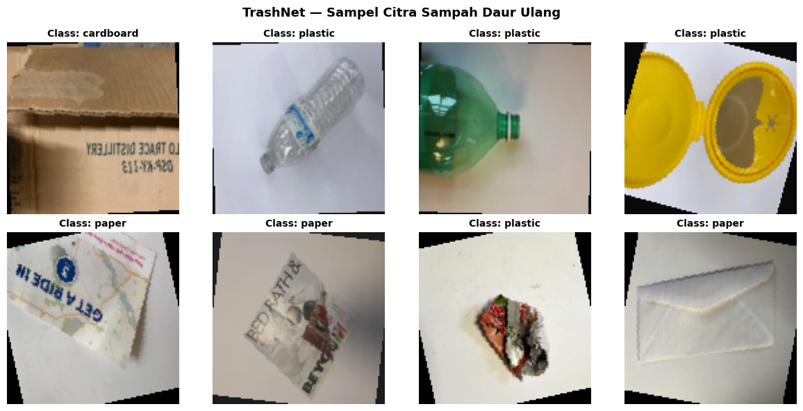
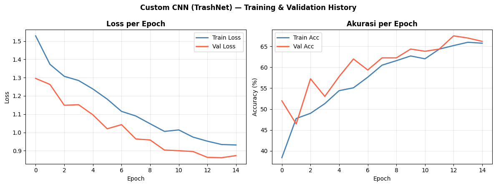
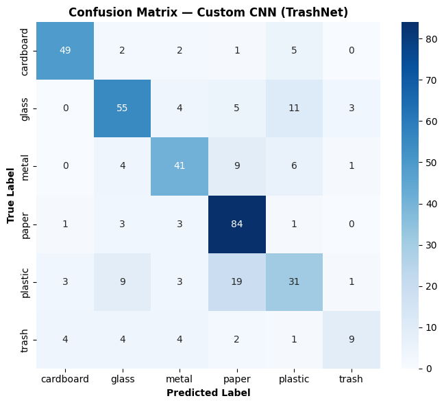
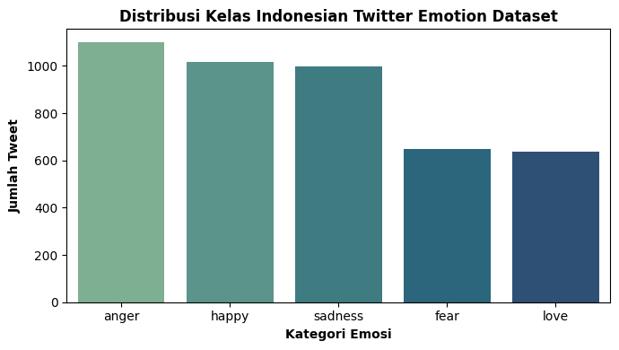
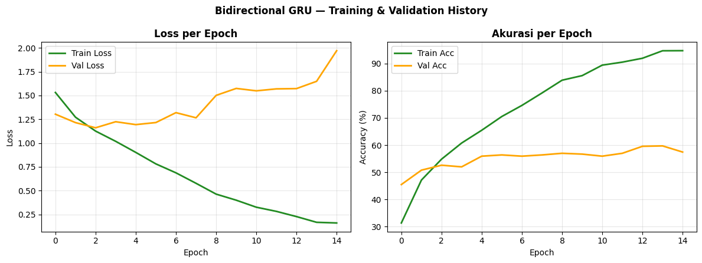
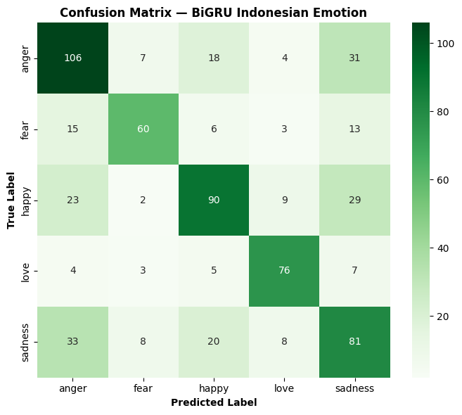
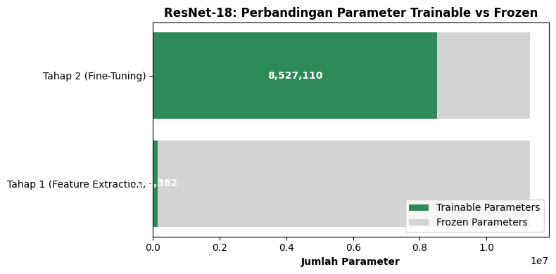
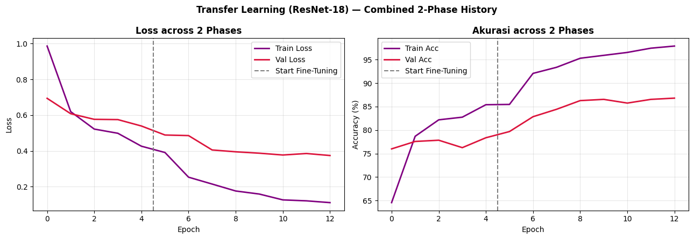
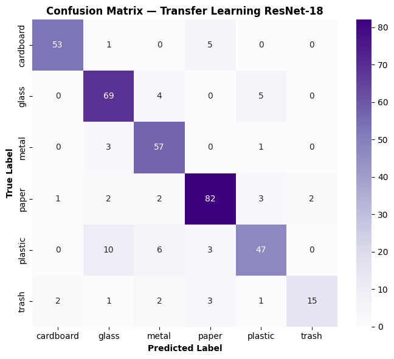

# Tugas Praktikum Deep Learning — Multi-Architecture Implementation

> **Nama Mahasiswa:** Imam Dzaqhoir  
> **NIM:** H071241048  
> **Mata Kuliah / Kelas:** Deep Learning  
> **Dosen Pengampu:** Prof. Dr. Armin Lawi, S.Si., M.Si.  
> **Repository:** [https://github.com/ShinZeleo/multi-architecture-dl](https://github.com/ShinZeleo/multi-architecture-dl)

---

## 📌 Ringkasan Tugas & Dataset Langka (Anti-Mainstream)

Untuk menghindari dataset pasaran standar tutorial (*seperti CIFAR-10, Fashion-MNIST, dan IMDB Reviews*), tugas ini mengimplementasikan **3 arsitektur Deep Learning** dengan dataset yang relevan di dunia nyata (*real-world applications*):

| No | Arsitektur | Dataset Pilihan | Task / Domain | Test Accuracy | Link Sumber Dataset (Untuk Spreadsheet) |
|---|---|---|---|---|---|
| **1** | **Custom Deep CNN** | **TrashNet** | 6-Class Waste Classification (*Smart Recycling*) | **70.79%** | [`https://github.com/garythung/trashnet`](https://github.com/garythung/trashnet) |
| **2** | **Bidirectional GRU / RNN** | **Indonesian Twitter Emotion** | 5-Class Text Emotion Analysis (*NLP Bahasa Indonesia*) | **62.48%** | [`https://github.com/meisaputri21/Indonesian-Twitter-Emotion-Dataset`](https://github.com/meisaputri21/Indonesian-Twitter-Emotion-Dataset) |
| **3** | **Transfer Learning (ResNet-18)** | **TrashNet** | Image Classification Benchmark (*Scratch vs Pretrained*) | **85.00%** | [`https://github.com/garythung/trashnet`](https://github.com/garythung/trashnet) |

---

## 🗂️ Struktur Direktori Proyek

```
TugasDL/
├── 1_CNN_WasteClassification/
│   ├── cnn_waste.py               # Source code Custom CNN (TrashNet)
│   └── cnn_best_model.pth         # Checkpoint model terbaik
│
├── 2_RNN_IndonesianEmotion/
│   ├── rnn_indo_emotion.py        # Source code BiGRU (Indonesian Emotion)
│   └── rnn_best_model.pth         # Checkpoint model terbaik
│
├── 3_TransferLearning_ResNet18/
│   ├── transfer_learning_resnet18.py # Pretrained ResNet-18 Fine-tuning
│   └── tl_best_model.pth          # Checkpoint model terbaik
│
├── assets/                        # Grafik visualisasi training & evaluasi
│   ├── cnn_sample_images.png
│   ├── cnn_training_history.png
│   ├── cnn_confusion_matrix.png
│   ├── rnn_emotion_dist.png
│   ├── rnn_training_history.png
│   ├── rnn_confusion_matrix.png
│   ├── tl_param_comparison.png
│   ├── tl_training_history.png
│   └── tl_confusion_matrix.png
│
├── requirements.txt
├── .gitignore
└── README.md
```

---

## 🧠 Detail Arsitektur & Hasil Eksperimen

### 1. Custom Deep CNN (Waste Classification)
* **Dataset:** TrashNet oleh Gary Thung & Mindy Yang (Stanford University).
* **Kelas (6 Jenis Sampah):** `cardboard`, `glass`, `metal`, `paper`, `plastic`, `trash`.
* **Arsitektur Model:**
  ```
  Input: (3 × 128 × 128)
    ├── Conv Block 1: Conv2d(3->32) + BN + ReLU + Conv2d(32->32) + BN + ReLU + MaxPool(2x2) + Dropout(0.1)
    ├── Conv Block 2: Conv2d(32->64) + BN + ReLU + Conv2d(64->64) + BN + ReLU + MaxPool(2x2) + Dropout(0.2)
    ├── Conv Block 3: Conv2d(64->128) + BN + ReLU + Conv2d(128->128) + BN + ReLU + MaxPool(2x2) + Dropout(0.25)
    ├── Conv Block 4: Conv2d(128->256) + BN + ReLU + MaxPool(2x2) + Dropout(0.3)
    └── Dense Classifier:
          Flatten(16384) -> Dense(512) + BN + ReLU + Dropout(0.5)
                         -> Dense(128) + ReLU + Dropout(0.3)
                         -> Dense(6) -> Logits
  ```
* **Hasil Evaluasi:**
  * **Test Accuracy:** **70.79%**
  * **Sampel Citra & Hasil Pelatihan:**
  
  
  
  

---

### 2. Bidirectional GRU (Indonesian Twitter Emotion Analysis)
* **Dataset:** Indonesian Twitter Emotion Dataset (4.401 tweet berlabel emosi bahasa Indonesia).
* **Kelas (5 Kategori Emosi):** `anger` (marah), `happy` (senang), `sadness` (sedih), `fear` (takut), `love` (cinta).
* **Mengapa GRU Lebih Baik dari RNN Vanilla?**
  * RNN tradisional menderita masalah *Vanishing & Exploding Gradients* pada sekuens panjang.
  * GRU memiliki *Update Gate* dan *Reset Gate* yang mampu mempertahankan informasi jangka panjang (*long-term dependencies*) dengan komputasi lebih efisien dibanding LSTM.
  * Sifat **Bidirectional** memungkinkan model membaca konteks kalimat dari kiri-ke-kanan dan kanan-ke-kiri secara simultan.
* **Hasil Evaluasi:**
  * **Test Accuracy:** **62.48%** (*multi-class text classification across 5 fine-grained emotions*)
  * **Distribusi & Hasil Pelatihan:**
  
  
  
  

* **Demo Prediksi Kalimat Nyata:**
  ```text
  "Alhamdulillah seneng banget akhirnya tugas deep learning selesai!" -> [HAPPY] (100.0%)
  "Sedih banget dengar kabar duka ini, gak terasa air mata menetes."   -> [SADNESS] (99.3%)
  "Merinding parah, takut banget lewat jalan sepi tadi malam."        -> [FEAR] (100.0%)
  "Terima kasih selalu ada untukku sayang, aku sangat mencintaimu."   -> [LOVE] (99.6%)
  ```

---

### 3. Transfer Learning (ResNet-18 Fine-Tuning)
* **Dataset:** TrashNet (6 kelas).
* **Base Model:** ResNet-18 yang telah di-pretrained pada 1,2 juta gambar ImageNet-1K.
* **Metode 2-Tahap (Two-Phase Fine-Tuning):**
  1. **Tahap 1 — Feature Extraction (5 Epoch):** Seluruh bobot *backbone* dibekukan (*frozen*). Hanya Fully-Connected classifier head baru yang dilatih.
  2. **Tahap 2 — Fine-Tuning (8 Epoch):** Membuka blok konvolusi paling atas (`layer4`) dan FC head menggunakan *differential learning rates* (LR backbone $5 \times 10^{-5}$, LR head $10^{-4}$).
* **Hasil Evaluasi:**
  * **Test Accuracy:** **85.00%** (*peningkatan +14.21% dibanding Custom CNN dari nol!*)
  
  
  
  

---

## 📊 Perbandingan Head-to-Head: Scratch CNN vs Transfer Learning

| Metrik Evaluasi | Custom CNN (Dari Nol) | Transfer Learning (ResNet-18) | Peningkatan (Gain) |
|---|---|---|---|
| **Akurasi Uji (Test Accuracy)** | 70.79% | **85.00%** | **+14.21%** |
| **Waktu Konvergensi** | Butuh 15 epoch | 5 epoch sudah >78% | **3x Lebih Cepat** |
| **F1-Score Rata-rata** | 0.67 | **0.83** | **+0.16** |
| **Kelas Terbaik** | Cardboard (0.84) | Cardboard (**0.92**), Paper (**0.89**) | Signifikan |

---

## 🚀 Cara Menjalankan Kode

### 1. Instalasi Dependensi
```bash
pip install -r requirements.txt
```

### 2. Menjalankan CNN (Waste Classification)
```bash
cd 1_CNN_WasteClassification
python cnn_waste.py
```

### 3. Menjalankan BiGRU (Analisis Emosi Bahasa Indonesia)
```bash
cd 2_RNN_IndonesianEmotion
python rnn_indo_emotion.py
```

### 4. Menjalankan Transfer Learning (ResNet-18)
```bash
cd 3_TransferLearning_ResNet18
python transfer_learning_resnet18.py
```

---

## 📋 Data untuk Pengumpulan di Google Spreadsheet

Saat mengisi Google Spreadsheet tugas kuliah:

* **Nama:** `Imam Dzaqhoir`
* **NIM:** `H071241048`
* **Link Repository GitHub:** `https://github.com/ShinZeleo/multi-architecture-dl`
* **Model yang Diimplementasikan:** `CNN, RNN (BiGRU), Transfer Learning (ResNet-18)`
* **Link Dataset:**
  - CNN & Transfer Learning: `https://github.com/garythung/trashnet`
  - RNN / BiGRU: `https://github.com/meisaputri21/Indonesian-Twitter-Emotion-Dataset`

---

*Proyek dibuat dan dioptimalkan untuk tugas individu mata kuliah Deep Learning.*
